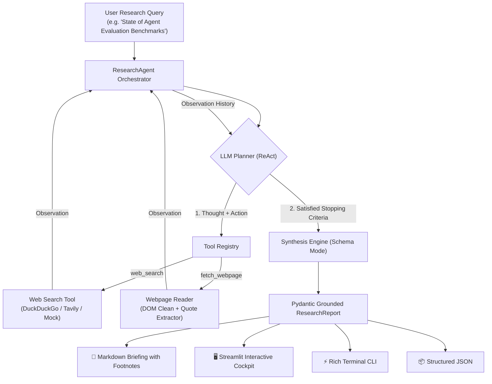

# 🔬 ResearchScout

> **Autonomous technical research assistant.** Investigates complex engineering and market questions through multi-turn tool calling, verifiable footnote citations, and grounded evidence extraction.

[](https://python.org)
[](https://pydantic.dev)
[](https://github.com)
[](https://opensource.org/licenses/MIT)
[](mailto:afsalkp.mohammed@gmail.com)

---

## 💡 The Problem

Standard LLMs suffer from three critical flaws when performing technical or competitive research:
1. **Source Hallucination:** Models fabricate credible-sounding URLs and quote papers that do not exist.
2. **Knowledge Cutoffs & Freshness:** Static training data cannot analyze recent benchmarks, library releases, or pricing changes.
3. **Single-Turn Guesswork:** Complex technical questions require iterative querying—searching, inspecting initial snippets, following up on deep technical documentation, and synthesizing conflicting evidence.

**ResearchScout** implements an autonomous **ReAct (Reasoning + Acting)** research loop. It plans search strategies, calls web tools, reads primary source pages, and synthesizes structured briefings where every factual claim references a verified, numbered footnote citation with a verbatim quote.

---

## 🏗️ Architecture



---

## ✨ Key Features

1. **ReAct Tool-Calling Loop:** Implements multi-turn `Thought -> Action -> Observation` planning from first principles.
2. **Grounded Footnote Citations:** Every claim links to a verifiable `[1]`, `[2]` citation containing the source URL, title, and an exact `quote_snippet`.
3. **Multi-Tool Architecture:**
   * `web_search`: Queries real-time search engines for technical documentation and news.
   * `fetch_webpage`: Deeply parses specific pages, stripping HTML noise to extract primary empirical data.
4. **Clean Code & SOLID Design:**
   * **Open/Closed:** Add new tools by subclassing `BaseTool` without altering the agent loop.
   * **Dependency Inversion:** Orchestrator depends on `BaseLLMProvider` and `BaseTool` abstractions, decoupling business logic from external API SDKs.
5. **Zero-Config Offline Mode:** Includes a deterministic `--mock` engine with pre-seeded technical benchmarks so recruiters and developers can run the entire agent instantly without external API keys.

---

## 🖥️ Terminal CLI Preview

```text
─── Step 1 ───
💭 Thought: I will perform an initial web search to discover primary benchmark data and sources.
⚡ Action: web_search(query='LLM multi-step agent evaluation benchmarks 2026')
👁️ Observation: [1] Title: HELM Benchmark (URL: https://crfm.stanford.edu/helm/latest/)...

─── Step 2 ───
💭 Thought: The initial search returned high-relevance sources. I will fetch the top technical document.
⚡ Action: fetch_webpage(url='https://crfm.stanford.edu/helm/latest/')
👁️ Observation: HELM assesses models across multiple axes including accuracy, calibration, toxicity...

─── Step 3 ───
✓ Status: Research Concluded

                                        💡 Key Findings & Evidence
┏━━━┳━━━━━━━━━━━━━━━━━━━━━━━━━━━━━━━━━━━━━━━━━━━━━━━━━━━━━━━━━━━━━━━━━━━━┳━━━━━━━━━━━┓
┃ # ┃ Claim & Technical Explanation                                      ┃ Citations ┃
┡━━━╇━━━━━━━━━━━━━━━━━━━━━━━━━━━━━━━━━━━━━━━━━━━━━━━━━━━━━━━━━━━━━━━━━━━━╇━━━━━━━━━━━┩
│ 1 │ Single-metric benchmarks fail to capture multi-step agent failures │    [1]    │
│   │ Agents fail predominantly in tool dispatch drift and loop stops.   │           │
│ 2 │ Step-level trajectory evaluation is standard in production         │  [1], [2] │
│   │ Frameworks advocate unit testing tools in deterministic sandboxes. │           │
└───┴────────────────────────────────────────────────────────────────────┴───────────┘
```

---

## ⚖️ Engineering & Product Trade-offs (AI PM Rationale)

| Decision | Choice | Rationale & Trade-off |
| :--- | :--- | :--- |
| **Stopping Criteria** | Fixed `max_steps` + Agent Self-Check | Runaway agent loops explode API budgets. Enforcing a hard ceiling (e.g. 4 steps) alongside an autonomous termination check ensures deterministic cost control. |
| **Content Truncation** | 2,500 Char Budget per Page | Feeding full 50,000-word webpages consumes tokens rapidly and causes context dilution ("lost-in-the-middle"). Extracting clean text snippets keeps latency under 2 seconds. |
| **Tool Registry vs Hardcoded Functions** | Abstract `ToolRegistry` | Decouples tool execution from model prompt structure, allowing hot-swapping between Gemini, OpenAI, or local fine-tuned models without rewrites. |
| **Strict Citations vs Free Text** | Validated `Citation` Model | Forcing the agent to map findings to numbered citations prevents speculative reasoning and provides a verifiable audit trail. |

---

## 🚀 Quickstart

### 1. Clone & Set Up Environment

```bash
cd ~/Desktop/research-scout

# Create and activate virtual environment
python3 -m venv .venv
source .venv/bin/activate

# Install dependencies
pip install -r requirements.txt
```

### 2. Configure Environment (Optional for Live Web Search & AI)

```bash
cp .env.example .env
# Edit .env and insert your free Gemini API key:
# GEMINI_API_KEY=your_key_here
```

*(Note: You can skip this step and use `--mock` to evaluate offline immediately!)*

---

## 💻 Usage

### Run via Command Line Interface (CLI)

Run instant offline demo on agent benchmarks:
```bash
python3 -m research_scout.cli -q "LLM agent evaluation benchmarks" --mock
```

Export research briefing to Markdown and JSON:
```bash
python3 -m research_scout.cli -q "Vector database comparison" --mock -o ./outputs
```

Run live search with Google Gemini:
```bash
python3 -m research_scout.cli -q "Recent developments in KV cache compression" -p gemini
```

### Run Interactive Web Dashboard

Launch the Streamlit research cockpit:
```bash
streamlit run app.py
```
* Navigate to `http://localhost:8501` to test interactive research queries, watch live agent reasoning steps, and download publication-ready Markdown briefings.

---

## 🧪 Automated Testing

Run the test suite:
```bash
pytest -v
```

Tests cover:
* ReAct execution cycle and observation feedback.
* ToolRegistry dispatching and error boundary resilience.
* Citation index validation and Pydantic report serialization.
* Max-step loop termination guardrails.

---

## 📂 Project Structure

```
research-scout/
├── app.py                      # Streamlit interactive research cockpit
├── research_scout/
│   ├── __init__.py             # Package init
│   ├── models.py               # Pydantic schemas (SearchQuery, Citation, Report, ToolCall)
│   ├── tools/
│   │   ├── __init__.py
│   │   ├── base.py             # Abstract BaseTool and ToolRegistry
│   │   ├── search.py           # DuckDuckGo, Tavily & Mock Search
│   │   └── fetch.py            # Webpage cleaner & quote extractor
│   ├── agent/
│   │   ├── __init__.py
│   │   ├── prompts.py          # ReAct system prompts & grounding rules
│   │   ├── providers.py        # Gemini, OpenAI, and Mock providers
│   │   └── orchestrator.py     # ResearchAgent ReAct loop & budget guards
│   ├── export.py               # Publication-ready Markdown & JSON
│   └── cli.py                  # Rich terminal UI with live step rendering
├── tests/
│   ├── __init__.py
│   ├── test_models.py          # Schema validation tests
│   ├── test_tools.py           # Tool dispatching tests
│   └── test_agent.py           # ReAct loop & termination tests
├── pyproject.toml              # Build & package configuration
├── requirements.txt            # Minimal dependencies
└── README.md                   # Project documentation & trade-offs
```

---

## 📜 License
MIT License. Copyright (c) 2026 Afsal (afsalkp.mohammed@gmail.com).
